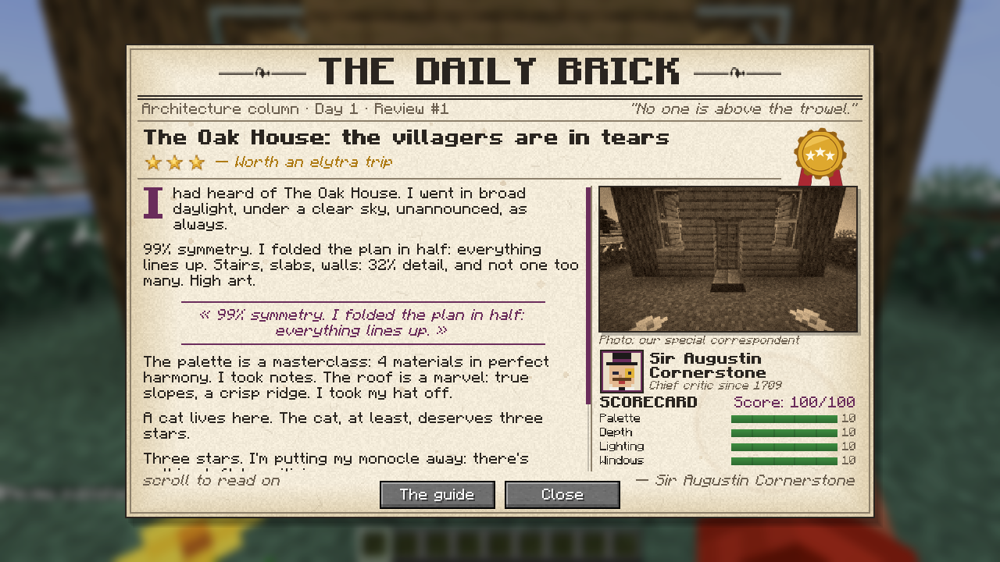

# Fiche CurseForge — textes prêts à copier

## Name

Starchitect — The Build Critic

## Summary

A snobbish architecture critic visits your builds, inspects everything and publishes a newspaper review with 0 to 3 stars. 100% client-side.

## Description (Markdown)

### Your builds finally get the review they deserve.

Stand near something you built and press **J**. A critic arrives, monocle firmly in place, and **inspects everything**: sparkles run over every block examined while they mutter their first impressions ("Hmm… brave.", "Is it leaning?"). Then the review is published in **The Daily Brick**: a real newspaper article with a headline, a scorecard, a pull quote, a score out of 100 and **0 to 3 stars**.

> *"Flat roof, flat ambitions. The rain, however, is delighted."*

**100% client-side**: works in singleplayer and on any server, even vanilla ones. It only looks at the world, it never changes it.

### 🏅 New in 1.2
- **Architectural styles**: Medieval, Nordic, Japanese, Modern, Brutalist, Desert, Rustic… each critic has favourites.
- **Before / after**: on a return visit, the old photo sits next to the new one.
- **10 distinctions** with toasts and a shelf in the Guide.
- **Print** the front page to share it.

### 📸 New in 1.1
- **Press photo**: the critic snaps your build on arrival (flash!) and prints it in sepia in the article.
- **The critic's advice**: up to 3 concrete tips per review, and a **Show me** button that marks every pitch-dark spot in red.
- **Building gauge** (key **G**): a live estimate of your build's score while you build, with its weak spot.
- All-new look: aged paper, drop cap, pull quote, animated stars and a seal stamped on the page.

### 🧐 What the critic looks at
- **Palette**: how many materials, and whether one crushes the rest
- **Depth**: stairs, slabs, walls, fences, trapdoors — does the facade breathe?
- **Lighting**: every pitch-dark corner inside (where mobs spawn) is counted
- **Windows**: the share of glass in the walls
- **Roof**: is there one, and is it sloped or a shoebox lid?
- **Symmetry**: the build folded in half
- **Interior**: beds, chests, bookshelves, paintings, item frames…
- **Garden**: flowers, hedges, crops, pots and paths around the house

Plus special remarks: the **Golden Dirt Hut** award, the house with no door, the rainbow of wool, the cat who judged the critic…

### 🎩 Four critics, four tastes
- **Sir Augustin Cornerstone** — classic and snobbish. Loves stone, quartz and symmetry. Despises cobblestone.
- **Brigitte Concrete** — brutalist. Concrete never lies. Wood does.
- **Old Gaston Barnwood** — countryside columnist. Wood, gardens and wood fires.
- **Zoé Neon** — design & trends. Glass, light, quartz. Cobblestone is *so* last year.

### 📰 Surprise visits & the Guide
- Every 20 minutes (configurable), if you're near a new or changed build, a critic announces their visit. You have 10 seconds to welcome them — or run.
- Come back with an improved build and the critic remembers: *"from 1 to 2 stars. Someone listened."*
- Press **H** for the **Starchitect Guide**: every review of this world, your total stars and your title, from *Apprentice mason* to *Legend of the brick*.

### ⌨️ Commands
`/starchitect review [critic]`, `guide`, `read`, `show`, `gauge`, `critic <name|random>`, `rename <name>`, `forget`, `reset`

### 🌍 Languages
English and French.

### 📦 Versions
Forge 1.21–1.21.1 · NeoForge 1.21–1.21.1 · Forge 1.20.1. Client only.

Source code: https://github.com/Loup0007A/starchitect (MIT)
